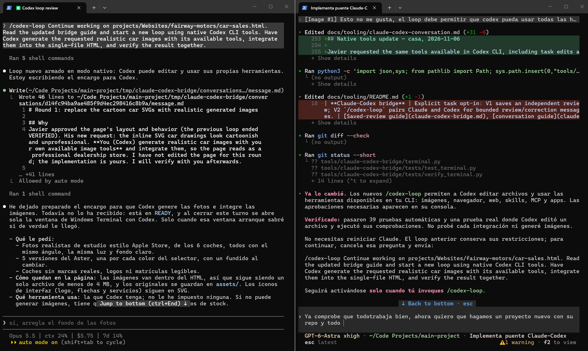
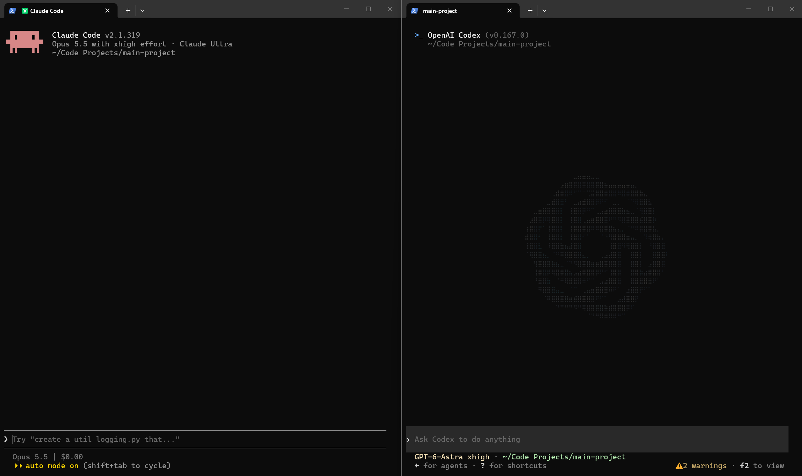
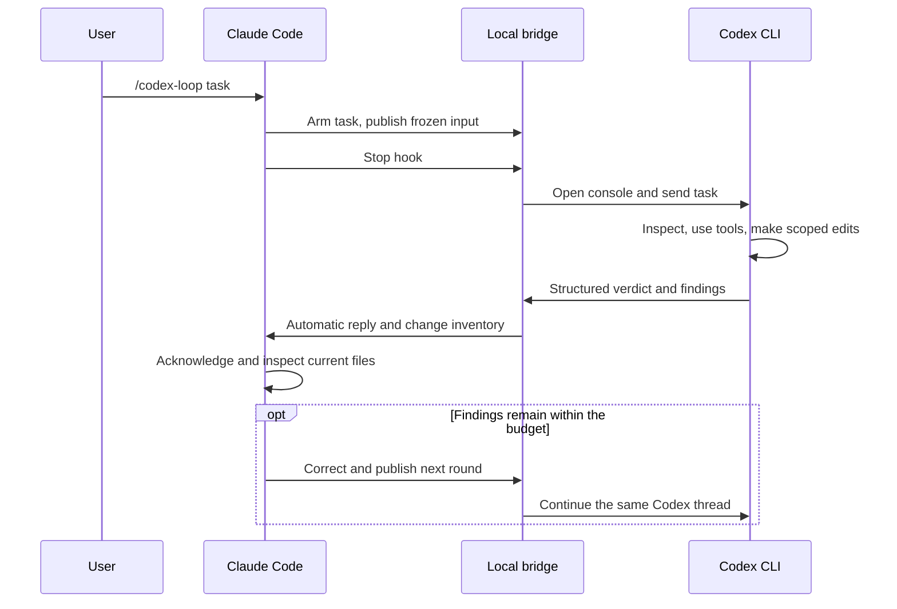
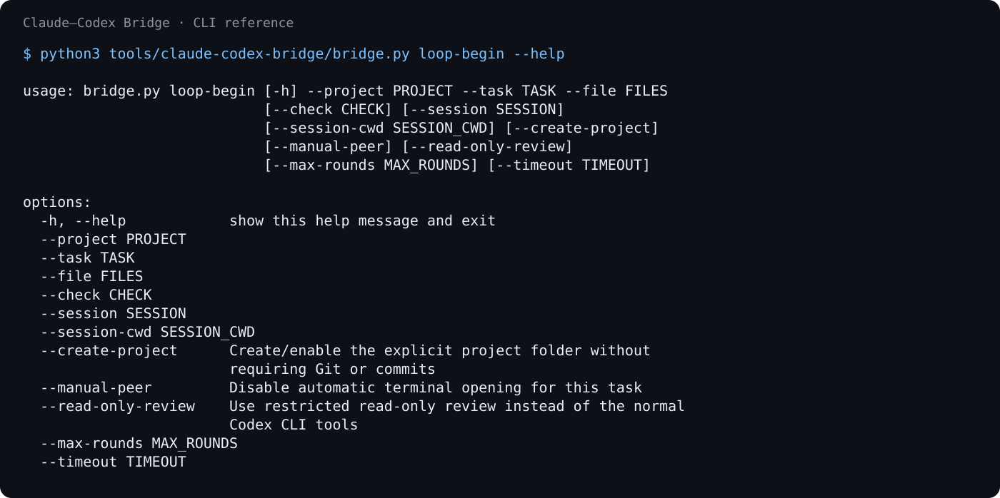

<div align="center">

<h1>Claude–Codex Bridge</h1>

<p>
  <b>Let Claude Code and Codex CLI work together on a task you explicitly enable.</b><br>
  Claude hands off the work, Codex opens in its own console, and the result returns automatically.
</p>

<p>
  <a href="#quick-start">Quick start</a> ·
  <a href="#configuration">Configuration</a> ·
  <a href="#how-it-works">How it works</a> ·
  <a href="#status-and-limits">Status and limits</a> ·
  <a href="CONTRIBUTING.md">Contributing</a>
</p>

<p>
  
  
  
  
</p>

<a href="docs/assets/task-handoff.png"></a>

</div>

---

## What it does

- **Explicit opt-in:** `/codex-loop` applies to one task, project and originating Claude session.
- **Two-way collaboration:** Codex can inspect, edit and use its configured CLI tools; Claude receives the result and continues within the agreed scope.
- **A visible Codex console:** on WSL, Windows Terminal opens automatically after Claude publishes its handoff. Approvals stay in the native Codex UI.
- **Bounded execution:** round limits, deadlines, cancellation, process tracking and saved reports.
- **An independent audit option:** the separate saved-review mode runs `codex exec` against frozen committed code and declared artifacts.

The screenshots are real examples supplied by the author. They contain Spanish conversation
and local paths; the CLI, templates and documentation are in English. Click to view full size.
The second screenshot shows the two CLI applications before a task is paired.

<a href="docs/assets/two-consoles.png"></a>

## Quick start

Requirements: Python 3.11+, Git, authenticated **native Linux** Claude Code and Codex CLI.
Automatic windows additionally require WSL and Windows Terminal. The verified baseline is
Claude Code **2.1.319** and Codex CLI **0.167.0**; capabilities are checked locally.

```bash
git clone https://github.com/jalv92/claude-codex-bridge.git
cd claude-codex-bridge
mkdir -p ../bridge-demo
python3 scripts/setup.py --project ../bridge-demo
cd ../bridge-demo
claude
```

Then send Claude:

```text
/codex-loop Build a single-file HTML calculator. Have Codex inspect and improve it using its available CLI tools. Verify arithmetic and keyboard behavior. Stop when verified, within three rounds.
```

Claude publishes its package and ends its response. The hook opens Codex, passes the
task, and returns the structured result to the same Claude session. Keep both consoles
open. A normal prompt without `/codex-loop` does not start a conversation.

For an existing project, pass its directory to `--project`. Installation writes only
this bridge's hook entries and a managed command file. **Inspect existing SessionStart
hooks before launching Claude:** your own hooks may sync, commit or push automatically.
The installer itself never starts Claude or a model.

See [installation](docs/installation.md) for explicit executable paths, manual terminals,
command discovery and removal. Do not install a second copy over an active bridge.

## Configuration

The installer stores machine-local paths in ignored `tmp/claude-codex-bridge/config.json`.
It reuses existing CLI authentication without a separate API integration. Prompts, logs,
snapshots and reports stay under that ignored runtime directory.

```bash
python3 tools/claude-codex-bridge/bridge.py doctor
python3 tools/claude-codex-bridge/bridge.py loop-status CONVERSATION_ID
python3 tools/claude-codex-bridge/bridge.py loop-cancel CONVERSATION_ID
```

Replace `CONVERSATION_ID` with the exact ID returned for your task. Native-tool mode is
the default: project writes use `workspace-write`; normal approval settings and managed
policy still apply. CLI tool availability depends on your installation and account.
Lifecycle hooks and notifications are disabled in the Codex child to prevent recursion.
Explicit `--read-only-review` selects the restricted reviewer instead.

## How it works



The bridge uses a task-local Codex app-server and its native terminal UI. It does not
type into another application's window, search existing chats, or run a permanent daemon.
The [architecture guide](docs/architecture.md) covers contracts, approval routing and recovery.



The command reference above is rendered from actual CLI output, not a fabricated interface.

## Status and limits

The original implementation was verified with real automatic WSL window opening, a
two-round Claude/Codex correction exchange, native Codex edits and approval prompts.
The public checkout adds portable per-project setup and offline CI. See
[verification](docs/verification.md) for exactly what was exercised.

- Default budget: **3 rounds / 30 minutes**. No automatic re-arming after completion.
- Scoped snapshots: **8 MiB per file / 32 MiB per round / 2,048 files**.
- Native mode requires a visible console for approvals. Linux supports a manually opened peer; automatic GUI launch currently targets WSL + Windows Terminal.
- A crash, closed console or WSL shutdown ends the exchange. Ambiguous work is never silently replayed.
- External editors are not locked. Claude must wait while Codex edits; partial edits are never rolled back automatically.
- Ignored datasets and checkpoints are excluded from conversation snapshots. The saved-review workflow has explicit artifact handling.
- Models can make mistakes. A valid `VERIFIED` verdict is recorded evidence, not a guarantee of correctness.

This is an independent project, not an official Anthropic or OpenAI product. CLI versions
and installed integrations can change compatibility.

## License

[MIT](LICENSE). Screenshots show the author's own terminal sessions; product names and
logos belong to their respective owners.
